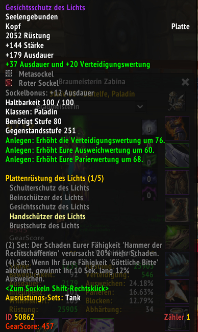
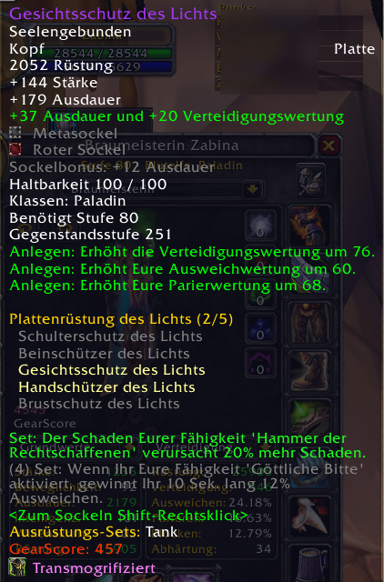
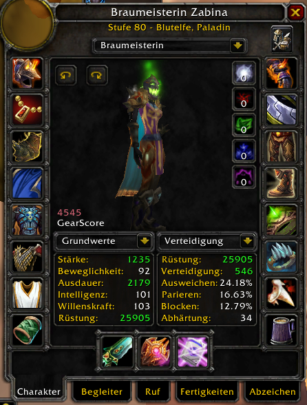
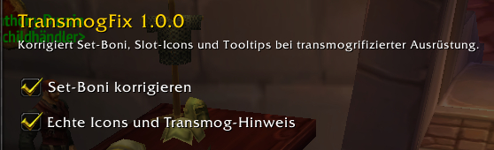

# TransmogFix

Addon for WoW 3.3.5a servers with transmogrification (e.g. Rising Gods). With transmog the
client takes the look item for some things it reads from your visible gear. TransmogFix
corrects what shows up wrong:

- **Set bonuses:** item tooltips count a transmogged set piece as missing, e.g.
  "(1/5)" instead of "(2/5)", and its set bonuses stay grey. TransmogFix recounts from the
  gear you really wear and lights up the pieces and active bonuses.
- **Slot icons:** the character window shows the icon of the look item in a transmogged
  slot. TransmogFix puts the icon of the real item back.
- **Transmog hint:** the tooltip of a transmogged slot gets a line "Transmogrified" with the
  icon of the look.

Without transmog nothing changes: the set count is only ever raised, and a slot only counts
as transmogged when its icon differs from the real item's icon.

## Screenshots

Helm transmogged to the Horseman's helm, the real helm and the gloves are pieces of the set.

| Without TransmogFix | With TransmogFix |
| --- | --- |
|  |  |

The character window shows the real helm icon (top left) while the model keeps the look:

## Options

Interface > AddOns > TransmogFix, or `/transmogfix`. Both parts can be switched off.

## Limits

- The 3D model keeps the transmog look, that is what the server shows to everyone.
- The client only exposes the icon of the look, not its name.
- When the look item is itself a piece of the same set, the client counts one piece too
  many; TransmogFix does not lower the count.
- Inspecting other players is left as it is.

## License

GPL v2, see [LICENSE](LICENSE).
